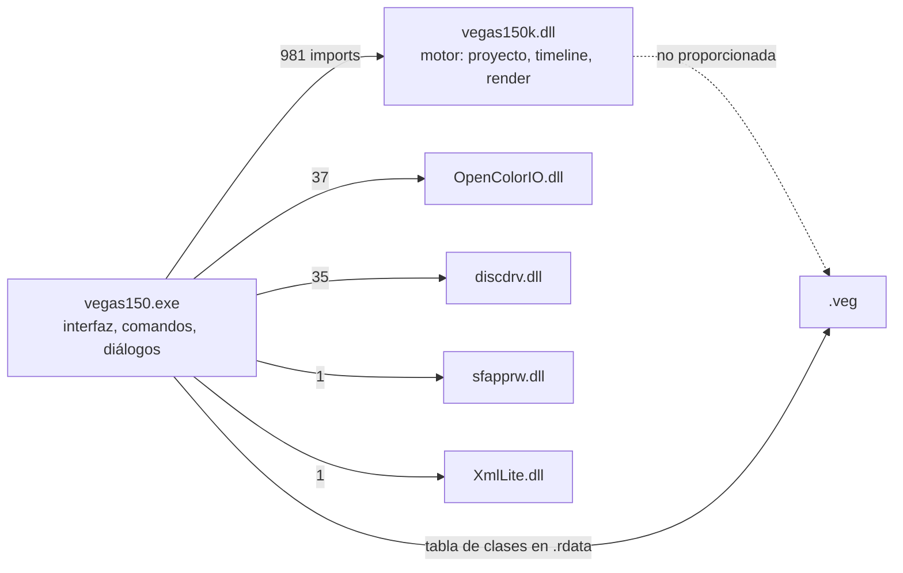

# REA de VEGAS Pro 15: el proyecto `.veg` y el ejecutable

Análisis pedido sobre dos artefactos proporcionados por el usuario:

| Artefacto | Tamaño | SHA-256 |
|---|---|---|
| `REA.veg` | 114 056 bytes | `68670635fadbab1fe1e0dbc3fef723e92c6f5aa3d75b18880539fcb31dac81d5` |
| `vegas150.exe` | 26 903 360 bytes | `a5ab9a558b32c5f90a6471010f2b348146d6c7e3d51166c20d638d785a4aa0e9` |

Además se usan dos proyectos que ya estaban en el repositorio (`tests/fixtures/vegas-real.veg`, el `adobe.veg` del
usuario, y `tests/fixtures/proyecto-ejemplo.veg`) para el análisis diferencial.

## 0. Cómo se hizo, y qué evidencia es cuál

Este informe distingue **tres tipos de evidencia**, porque no valen lo mismo:

1. **Evidencia REA** (la CLI `rea-agents` 6.5.0, que sí está disponible): dos operaciones ejecutadas sobre el
   ejecutable, con su identificador de evidencia:
   - `inspect_artifact` → `ev_59996631fb0973d2dd15632b97a9757bd833d78a2feadf77959f22aa2b614689`
     (manifiesto del artefacto: formato PE, un solo nodo, sin contenedores).
   - `inspect_pe_resources` → `ev_99cc58230a95b0d58887e4b41a525cb70ac6b22a6385999136c429cdb971711d`
     (PE32+, máquina 34404 = x64, **5 518 recursos** en 6 410 entradas, 5 grupos de iconos).
2. **Observaciones con herramientas corrientes** (Node y PowerShell sobre los bytes, y los guiones nuevos de
   `outputs/rea/`): todo lo demás. Están etiquetadas como tales y son reproducibles con los comandos del §9.
3. **Lo que no se pudo hacer, dicho aquí**: el servidor MCP de REA **no está conectado en esta sesión** y no hay
   motor de desensamblado instalado. `rea doctor --client dsh --json` (ejecutado) lo confirma:

   ```json
   {"healthy":false,
    "scope_checks":[{"name":"registration:dsh","ok":false,"classification":"config_drift"}],
    "informational_checks":[{"name":"hopper","ok":false,"classification":"missing_analysis_engine"},
                            {"name":"ghidra","ok":false,"detail":"GHIDRA_INSTALL_DIR is not set"},
                            {"name":"ida-registration","ok":false}]}
   ```

   Consecuencia honesta: **no hay decompilación ni pseudocódigo del binario**. Todo lo que sigue sobre el
   ejecutable es estático a nivel de cabeceras, importaciones, recursos, tabla de clases y cadenas. Donde el
   informe dice «inferencia», lo es; donde dice «no determinado», no se determinó.

## 1. Arquitectura: quién hace qué

El ejecutable es la **cáscara de interfaz**; el motor del proyecto y del render vive en una DLL que **no se
proporcionó**. Es la conclusión más importante del análisis y la que condiciona todo lo demás.

```
vegas150.exe  (26,9 MB, PE32+ x64, VEGAS Pro 15.0 build 177, 2017-08-13)
├── .text   12,4 MB  código de la interfaz y de los comandos
├── .rdata   4,3 MB  cadenas, tablas y la TABLA DE CLASES DEL PROYECTO (§3.4)
├── .data    0,7 MB  datos inicializados
├── .pdata   0,7 MB  descriptores de excepciones
├── .tls     512 B
├── .rsrc    8,3 MB  5 518 recursos (iconos, menús, diálogos, cadenas, BINARY, WAVE, VERSIONINFO)
└── .reloc   0,3 MB
        │
        │ importa (24 DLL, 2 240 funciones)
        ▼
vegas150k.dll   ← 981 funciones: EL MOTOR (audio, preferencias XML, búferes, tiempo-estiramiento)
                 NO proporcionada: aquí están el lector/escritor de .veg y el renderizador
OpenColorIO.dll ← gestión de color (37 funciones, ABI de OpenColorIO v1)
discdrv.dll     ← grabación de discos (CDiscRecorder/CDiscWriter)
ErrorReport.dll ← informes de fallo
sfapprw.dll     ← una sola función: RegApp_SpikeCheckAndRegister (registro de la aplicación)
XmlLite.dll     ← CreateXmlWriter (escritura de XML: preferencias y partes XML del proyecto)
MSVCP110/MSVCR110/VCOMP110 ← tiempo de ejecución de Visual C++ 2012 (y OpenMP)
KERNEL32/USER32/GDI32/GDI+/OLE32/OLEAUT/ADVAPI32/WS2_32/SHLWAPI/RPCRT4/WINTRUST/SETUPAPI/WTSAPI32/IPHLPAPI
```



Prueba de que la interfaz **no** contiene el lector del formato: en las 2 240 funciones importadas no hay ninguna
de proyecto (la única sospechosa, `sfapprw.dll`, expone `RegApp_SpikeCheckAndRegister`, que es registro de la
aplicación, no E/S de proyecto). Las cadenas del proyecto (`File.Open`, `File.Save`, `File.SaveAs`,
`ProjUI_RefreshMedia`, `*.veg;*.vf`) están en el ejecutable, pero son de la **capa de comandos e interfaz**;
el análisis de los bytes del `.veg` (§2) muestra un grafo de objetos con identificadores de clase que solo puede
resolver el motor.

> **Por qué no se analiza el motor aquí**: esta ronda trabaja **sólo con los artefactos proporcionados**, y
> `vegas150k.dll` no es uno de ellos. En rondas anteriores se identificó el de la instalación de este equipo
> (`C:\Program Files\VEGAS\VEGAS Pro 15.0\vegas150k.dll`, SHA-256
> `73d2b4aecabdb1e7c21ea9ecf5cd2f58d31ae6f1dcdf7a38c7a40d200798c019`, x86-64) con evidencia REA
> `ev_c79334f807fbe53f9edb21b374823567f5c8cef46c8ad1aeb3b4a7ebef11425c`, y es el módulo que habría que
> desensamblar para cerrar los campos del §2.2. Queda como el siguiente paso natural, no como algo hecho aquí.

## 2. El formato `.veg`, medido

### 2.1 Firma y contenedor

| Comprobación | `REA.veg` | `vegas-real.veg` |
|---|---|---|
| Primeros 4 bytes | `72 69 66 66` = `riff` (minúsculas, como `list`) | igual |
| Identificador de clase del archivo (12 bytes tras la firma) | `11cf912e-d6a5-db28-04c1-0000` | igual |
| 8 bytes en `0x10` | **24** | **95 248** (= tamaño del archivo) |
| GUID en `0x18` | `46c429ef-904a-11d2-8722-00c04f8edb8a` | igual |
| GUID en `0x28` | `b28f2d5a-230f-11d2-86af-00c04f8edb8a` | igual |
| 8 bytes en `0x38` | 24 | 2 936 |
| 4 bytes en `0x40` | 136 | 136 |
| 4 bytes en `0x44` | `0x000f0000` → **versión 15.0** | igual |
| 4 bytes en `0x4C` | 48 000 → **frecuencia de muestreo** | igual |
| Dobles en `0x50` y `0x58` | 60.0 y 120.0 | igual |

Corrección respecto del informe anterior (`ANALISIS-VEG.md`): la firma **no** es `riff.` de 5 bytes. Son `riff`
más un **identificador de clase de 12 bytes**, y su primer byte (`0x2e`, luego `0x2f` en los bloques) fue lo que
pareció un punto. La diferencia importa: el campo es un GUID truncado a 12 bytes, no un carácter de la firma.

El 8 bytes de `0x10` **no es el tamaño del archivo en los dos casos**: en `vegas-real.veg` coincide con el tamaño
(95 248) y en `REA.veg` vale 24. Como `vegas-real.veg` fue reescrito por otro programa (§2.5), la lectura más
prudente es que ese campo lo escribe cada programa a su manera. **No determinado**: su significado exacto.

### 2.2 Bloques: cabecera de 24 bytes y tamaño que incluye la cabecera

| Desplazamiento | Tamaño | Contenido |
|---|---|---|
| 0 | 4 | marca `list` (ASCII) |
| 4 | 12 | identificador de clase (`11cf912f-d6a5-db28-04c1-0000` en todos los bloques vistos) |
| 16 | 8 | **tamaño total del bloque**, incluida la cabecera (entero de 64 bits) |
| 24 | tamaño−24 | cuerpo |

La validación es aritmética y cierra exacto, que es lo que permite afirmarlo: en `REA.veg` los bloques de
`0x1020` (192 bytes) y `0x10E0` (520 bytes) se encadenan sin hueco (`0x1020+192 = 0x10E0`, `0x10E0+520 = 0x1300`,
y así los dieciséis). La suma de los bloques de primer nivel de `vegas-real.veg` da exactamente el tamaño del
archivo, como ya documentó `ANALISIS-VEG.md` (9 bloques de primer nivel, 187 bloques en total).

**Cuerpo de un bloque**: empieza por **identificadores de clase de 16 bytes** (en `REA.veg`, `fc2b3bce…` y
`fc2b3bcf…`), después una cantidad de 8 bytes y luego campos. En las zonas con nombre se ve el patrón
`[longitud u32][tipo u32][datos]`: el nombre `REA` está escrito como `08 00 00 00 | 02 00 00 00 | 52 00 45 00 41 00 00 00`
(longitud 8 = 3 caracteres + nulo, tipo 2 = texto UTF-16). Es una **pista fuerte**, no un esquema cerrado: al
intentar recorrer un bloque entero con esa regla el recorrido no llega al final, porque el cuerpo no empieza con
un campo sino con clases. **No determinado**: la tabla de tipos y el orden de campos de cada clase.

### 2.3 Inventario de clases: qué usa cada proyecto

| Clase | `REA.veg` | `vegas-real.veg` | ¿Está en la tabla del ejecutable? (§3.4) |
|---|---|---|---|
| `11cf912f…` (cabecera de bloque) | 16 | 187 | forma parte del contenedor |
| `46c429ef-904a-11d2-8722-…` | 1 (cabecera) | 1 | sí, `0xd237d0` |
| `b28f2d5a…` / `b28f2d5b…` / `b28f2d5d…` | 1 / — / — | 1 / 1 / 6 | sí |
| `4d6c0747/48/49/4a…` | — / — / — / 8 | 1 / 5 / 10 / **77** | sí |
| `168d206a/6d/6e…` | 8 / 8 / — | 77 / 77 / — | sí |
| `fc2b3bce` / `fc2b3bcf` | 8 / 8 | 38 / 38 | sí |
| `69d46c24…29` | — | 3 / 3 / 3 / 3 / 2 / 2 | sí |
| `1af0e4e5…`, `925f94bc…`, `71234f1d…`, `220d2be4…` | — | 2 / 1 / 1 / 1 | sí |

Lo que esto permite afirmar: **cada clase que aparece en los dos proyectos está en la tabla del ejecutable**, así
que el formato y el binario están relacionados por esa tabla (es el «registro de tipos» del serializador). Lo que
**no** permite afirmar: qué significa cada clase. La jerarquía de frecuencias (`4d6c0747` ×1 → `4d6c0748` ×5 →
`4d6c0749` ×10 → `4d6c074a` ×77 en el proyecto real) sugiere una cadena de contención proyecto → pista → … → evento,
pero es una **inferencia por conteo**, no una lectura del código.

### 2.4 Qué se puede leer con certeza del contenido

| Dato | `REA.veg` | `vegas-real.veg` |
|---|---|---|
| Ruta del proyecto | `C:\Users\<usuario>\OneDrive\Escritorio\REA.veg` | `…\adobe.veg` |
| Carpeta de documentos / salida | `C:\Users\<usuario>\OneDrive\Documentos` | igual |
| Carpeta de datos de VEGAS | `C:\Users\<usuario>\AppData\Local\VEGAS Pro\15.0\` | igual |
| Medios referenciados | **ninguno** | **4** (`Apps.mp4`, `faaah.mp3`, `Sunlight_on_Still_Water.mp3`, `Apps.mp4_audio.wav`) |
| Nombre repetido | `REA` ×8 | — |
| Títulos / RTF | no | **2** (`Títulos & Texto de VEGAS`, `Terremoto` con `ADOBE GRATIS`/`Y OPEN SOURCE`) |
| Parámetros de complementos | no | `{Svfx:com.sonycreativesoftware:titlesandtext}`, `TextColor`, `AnimationName`, `Scale`, `Location`, `OutlineWidth`, `ShadowOffsetX/Y`… |
| XMP | **no** | sí, 3 605 bytes en `0x136C` |
| Velocidad de fotogramas | no aparece ningún 29,97/30/60 dentro de los bloques; solo 60.0 y 120.0 en la cabecera | 29,97002997002997 en `0x29C`, `0x544`, `0x5E4`, `0x88C`, `0x92C`; 60.0 en `0x1FC` |
| Cadenas UTF-16 | 11 | 153 |
| Bloques `list` | 16 (todos `11cf912f`) | 187 |
| Bytes a cero | **98,7 %** del archivo | 63,2 % (por los ceros internos, no por relleno final) |

### 2.5 Dos hallazgos que cambian la lectura del formato

1. **`REA.veg` es un búfer de tamaño fijo.** Su último byte distinto de cero está en `0x1FD8` (8 152) y el archivo
   mide 114 056: hay **105 903 bytes de ceros al final**. Es lo que hace un programa que reserva un bloque y
   escribe dentro. Consecuencia práctica: un lector **no puede** tomar el tamaño del archivo como contenido, y un
   escritor puede tener que rellenar. `vegas-real.veg`, en cambio, termina limpio (9 bytes de relleno).
2. **`vegas-real.veg` lo reescribió otro programa.** Su XMP declara
   `stEvt:softwareAgent = Adobe Audition CC 2015.0 (Windows)` y `xmp:ModifyDate = 2026-10-08T09:48:10-07:00`,
   mientras que `REA.veg` (guardado por VEGAS) **no lleva XMP**. Diferencia de escritores, no de versión: los dos
   declaran la versión 15.0 en la cabecera y las mismas clases. Y `proyecto-ejemplo.veg` **no es un `.veg`**: tras
   `riff` dice, en ASCII y a la vista, `riff.ARCHIVO DE PRUEBA CON LA FIRMA DE UN PROYECTO VEGAS.Este archivo NO es
   un proyecto .veg rea…`; es el archivo de prueba que «solo imita la firma» y el lector lo rechaza por eso.

## 3. El ejecutable, medido

### 3.1 Identidad

| Dato | Valor | De dónde |
|---|---|---|
| Formato | PE32+ (magic `0x20b`), **x64** (máquina `0x8664`) | cabecera NT |
| Enlazado | **2017-08-13T00:28:06Z** | cabecera NT |
| Subsistema | 2 = Windows GUI; `DllCharacteristics 0x8040` (ASLR + Control Flow Guard) | cabecera NT |
| Punto de entrada | `0x885EC0`, base de imagen `0x140000000` | cabecera NT |
| Producto | **VEGAS Pro 15.0 (Build 177)**, `MAGIX Computer Products Intl. Co.`, `Copyright (c) 2017 MAGIX Software GmbH` | `VS_VERSIONINFO` en `0x17D325E` |
| Nombre original | `VEGAS150.EXE` | ídem |
| Recursos | 5 518 entradas, tipos propios (`BINARY`, `WAVE`, `VERSION`, `MANIFEST`, iconos…) | evidencia REA `ev_99cc5823…` |

### 3.2 Módulos, por la lista de importaciones

| Categoría del encargo | Módulo(s) que la cubren, según las importaciones |
|---|---|
| Carga de proyectos `.veg` | no hay función de proyecto importada: la E/S está en `vegas150k.dll` (no proporcionada). En el ejecutable, la capa de comandos (`File.Open`/`File.Save`/`File.SaveAs`, `openproject`, `ProjUI_RefreshMedia`) |
| Renderizado | `vegas150k.dll` (motor), `OpenColorIO.dll` (color), `XmlLite.dll` (partes XML); en la interfaz: `File.RenderAs`, `Tools.RenderAsDialog`, `Tools.RenderAsDialogToNewTrack`, `Tools.RenderAsDialogPrerender`, `RenderAs Settings Path` |
| Línea de tiempo | `vegas150k.dll`; en la interfaz, la ventana y sus comandos |
| Efectos | `vegas150k.dll`; en la interfaz `Vegas.Class.VideoFxx.Plexi`, `VideoFX_*`, `Options.BypassAllAudioFX`, `GlobalAudioFX_OverviewPRO` |
| Scripts | `ScriptPortal.Vegas.*` (con plantillas de C#, JScript y PowerShell dentro del propio ejecutable: `using ScriptPortal.Vegas;`, `Imports ScriptPortal.Vegas`, `public function Begin(app : ScriptPortal.Vegas.Vegas)`, `EntryPoint`) |
| VST | `vegas150k.dll` (el motor aloja los complementos); en el ejecutable aparece `NOVSTGROVEL` y la preferencia `Options.BypassAllAudioFX` |
| OFX | `vegas150k.dll`; en el ejecutable, la preferencia `OFX Detailed Plugin Log` |
| Grabación de discos | `discdrv.dll` (`CDiscRecorder`, `CDiscMaster`, `CDiscWriter`, `MediaIsBdWritable`…) |
| Diagnóstico | `ErrorReport.dll` (`ErrorReport_Initialize`, `_AddFile`, `_AddText`, `CommonExceptionFilter`) |
| Licencias | módulo propio `CCryptKey` / `CCodeCrypt::DecodeAes` (AES + base64) |

### 3.3 Cadenas que documentan flujos

- **Proyecto**: `*.veg;*.vf` (filtro del diálogo de apertura; `.vf` es el formato anterior), `.veg`,
  `.VEG`, `.veg_archive`, `Create project file backups (.veg.bak)`, `openproject`, `File.New`, `File.New.Quick`,
  `File.Open`, `File.Save`, `File.SaveAs`, `Recapturing media files failed.`,
  `ProjUI_RefreshMedia: refresh time = %I64d usec`.
- **Campos de un evento** (volcado/importación en CSV del propio VEGAS, `0xD23F80`): `"ID";"Track";"StartTime";
  "Length";"PlayRate";"Locked";"Normalized";"StretchMethod";"Looped";"OnRuler";"MediaType";"FileName";"Stream";
  "StreamStart";"StreamLength";"FadeTimeIn";"FadeTimeOut";"SustainGain";"CurveIn";"GainIn";"CurveOut";"GainOut";
  "Layer";"Color";"CurveInR";"CurveOutR";"PlayPitch";"LockPitch";"FirstChannel";"Channels"`. Es la lista de
  propiedades que el programa considera propias de un evento, y sirve de mapa semántico aunque el `.veg` las
  guarde en binario.
- **Otras**: `Error importing BWF file '%s'`, `VIDEO_TS.IFO`/`VR_MANGR.IFO`/`VR_MOVIE.VRO` (DVD/AVCHD),
  `TrkVfxDefaults.prefs`, `XDCAM recapture information`, `https://mediasoftwareapps.magix.com/v2/productinfo.asp…`.

### 3.4 La tabla de clases (el puente entre el `.veg` y el ejecutable)

En `.rdata`, a partir de `0xD237C0`, hay un bloque que empieza por la marca ASCII `list` y sigue con **40
identificadores de clase** consecutivos, con la firma clásica de Sonic Foundry (`…-00c04f8edb8a`). Es la **tabla
de tipos del serializador del proyecto**, y contiene **todas** las clases que aparecen en los dos `.veg`:

```
0xd237c0  "list"                     ← la marca de contenedor, con el mismo texto que en el archivo
0xd237d0  46c429ef-904a-11d2-8722-00c04f8edb8a   ← el GUID que va en la cabecera del .veg (0x18)
0xd23840  b28f2d5a / 5b / 5d…
0xd23870  4d6c0747 / 48 / 49 / 4a…   ← la familia con más apariciones en el proyecto real
0xd238c0  168d206a / 6d / 6e…
0xd238f0  90020ef4 / f5 / f6 / f7, abf76256…
0xd23940  925f94bc, 71234f1d, 220d2be4 / e2, 84701b5a / 5b / 5c / 5d…
0xd23a50  1af0e4e4 / e5 / e6, 6697a914, d52af8d4 / d5 / d7…
0xd23b00  fc2b3bce / cf…
0xd23b40  69d46c24 / 25 / 26 / 27 / 28 / 29
```

Esto es lo que permite afirmar que «el `.veg` lo interpreta el binario» sin haber ejecutado VEGAS: los
identificadores están escritos en los dos artefactos, byte a byte, y la marca `list` también.

## 4. Flujo de carga y guardado (reconstruido)

**Observado**: la tabla de clases, la marca `list`, las longitudes de bloque, las cadenas de comandos
(`File.Open`, `File.Save`, `File.SaveAs`, `openproject`), el mensaje de fallo de recaptura de medios, el CSV de
propiedades de evento y el módulo de preferencias XML del motor.
**Inferido** (y así se marca): el orden de las etapas y quién llama a quién.

```
Abrir .veg
  1. Interfaz (vegas150.exe): File.Open → diálogo con filtro "*.veg;*.vf" → ruta
  2. Motor (vegas150k.dll): abre el archivo, comprueba "riff" + clase de archivo (11cf912e)
  3. Recorre bloques: marca "list" + clase (12 B) + tamaño (8 B, incluye cabecera) → 24 B de cabecera
  4. Por cada bloque, resuelve su clase (16 B) contra la tabla de tipos (§3.4) y rellena el objeto:
        proyecto: versión (15.0), muestreo (48 000), 60.0/120.0, rutas de proyecto y de datos
        medios:   rutas UTF-16 + metadatos
        pistas/eventos: campos del mapa CSV (§3.3): StartTime, Length, PlayRate, Fades, Channels…
        efectos:  identificadores {Svfx:…} y sus parámetros con nombre (títulos en RTF, etc.)
  5. Avisa si un medio no está (el mensaje "Recapturing media files failed." es de esta fase)
  6. Construye la línea de tiempo y refresca los medios (ProjUI_RefreshMedia)
  7. Reproduce: lo que suena/renderiza lo compone el motor, con la cadena evento → pista → bus → maestro
Guardar .veg
  a. File.Save / File.SaveAs → el motor serializa el mismo grafo (los bloques no cambian de forma)
  b. Copia de seguridad: "Create project file backups (.veg.bak)" (preferencia; el .bak se escribe antes)
  c. El tamaño de cada bloque se recalcula al escribirlo (por eso el tamaño incluye la cabecera)
  d. VEGAS guarda en un búfer de tamaño fijo y deja el resto a cero (§2.5)
```

**No determinado**: el nombre de las funciones del motor que hacen 2-4 (no hay DLL ni desensamblador), y por
tanto la tabla de campos exacta de cada clase.

## 5. Automatización: qué se puede hacer y qué no

| Pregunta del encargo | Veredicto | Motivo, con la prueba |
|---|---|---|
| ¿Generar `.veg` mediante código? | **No, por esta vía** | Haría falta escribir el grafo de objetos con sus clases y campos; los campos no están determinados (§2.2, §4) y no hay forma de validar el resultado sin VEGAS. **Vía soportada**: los scripts de VEGAS (`ScriptPortal`) que crean el proyecto y lo guardan con su propio ejecutable |
| ¿Editar `.veg` automáticamente? | **Sí, con límites** | Edición **en el sitio y del mismo tamaño** (una ruta de igual longitud, un doble, un entero) es viable: los datos van *inline* en el bloque y **no se ha encontrado ninguna suma de comprobación** en las zonas leídas (solo marca, clase, tamaño y campos). Cambiar la **longitud** de una cadena obliga a rehacer los tamaños de los bloques que la contienen (la cadena lleva su longitud delante, `[longitud u32][tipo u32][datos]`, y el bloque la suya en la cabecera): es posible en teoría, pero **no verificado** |
| ¿Crear líneas de tiempo programáticamente? | Sólo por la vía soportada | `ScriptPortal.Vegas` (las plantillas están dentro del ejecutable) o el XML/EDL intermedios que el propio VEGAS exporta. Corte 15 ya usa las dos: el puente `.veg` (§6) y el XML/EDL |
| ¿Reemplazar medios? | **Sí, del mismo tamaño de cadena**; si no, ver arriba | Las rutas son cadenas UTF-16 con su longitud delante; el propio VEGAS detecta medios ausentes y ofrece recapturarlos (§3.3), así que un reemplazo puede hacerse también por la interfaz o por script |
| ¿Modificar efectos? | **No** | Los efectos se guardan como `{Svfx:…}` + parámetros con nombre dentro del bloque grande; sin la tabla de campos no se puede escribir un efecto nuevo con garantías (`ANALISIS-VEG.md` §3 lo dejó documentado como no implementado, y este análisis no lo cambia) |
| ¿Leer el proyecto (medios, nombres, parámetros)? | **Sí** | Rutas, nombre de proyecto, versión, muestreo y el XMP (si el archivo lo trae) se leen sin ambigüedad: es lo que ya hace `lib/editor/veg.ts` |

Un **lead no verificado** sobre el que merece la pena avisar: el ejecutable conoce una extensión `.veg_archive`
junto a `.VEG` y `.ACD-ZIP` (el formato de archivo del ACID). Si el «archive» de VEGAS fuese un ZIP con el proyecto
y sus medios dentro, sería un contenedor mucho más tratable que el `.veg` binario. **No se pudo comprobar**: no hay
ningún `.veg_archive` entre los artefactos proporcionados.

## 6. Relación con lo que ya hace Corte 15

- `lib/editor/veg.ts` **lee** el `.veg` (firma, tamaño declarado, bloques de primer nivel, rutas de medios, títulos)
  y `lib/editor/interchange.ts` reconstruye montajes desde XML/EDL. Este informe no cambia ese código: confirma lo
  que ya hacía y corrige una descripción (la firma es `riff` + clase de 12 bytes, no `riff.` de 5).
- `scripts/veg-bridge-server.mjs` + `lib/editor/veg-bridge.ts` usan **VEGAS real** por scripting para leer y
  escribir `.veg`. Es la única vía con la que este proyecto ha *ejecutado* la escritura de un `.veg`, y sigue
  siendo la recomendada.
- `ANALISIS-VEGAS-REA.md` §6-§7 documenta las cadenas y catálogos sacados del ejecutable y de las DLL de
  complementos; este informe añade la capa del **contenedor del proyecto** y la del **ejecutable completo**.

## 7. Riesgos y limitaciones

1. **Sin motor ni desensamblador**: el 981 funciones de `vegas150k.dll` no se pueden nombrar; falta el significado
   de los campos. Todo el §2.2-§2.3 está al nivel de contenedor, no de esquema.
2. **Dos muestras de proyecto, y una reescrita por otro programa**: cualquier conclusión sobre el *escritor* tiene
   ese sesgo; el tamaño declarado en `0x10` (24 frente a 95 248) es la prueba de que no hay una sola convención.
3. **Nada de esto observa ejecución**: no se abrió VEGAS. Lo que dice «al abrir, el motor hace X» es una
   inferencia marcada como tal.
4. **Privacidad**: un `.veg` guarda rutas absolutas del usuario (`C:\Users\<usuario>\…`, `G:\YouTube\…`). Los archivos
   de evidencia de este análisis las conservan; si se comparten, conviene sustituirlas.
5. **Fragilidad de la edición binaria**: sin suma de comprobación visible, un cambio de tamaño mal recalculado
   puede dejar un archivo que VEGAS rechace o, peor, que abra con el montaje mal colocado. `ANALISIS-VEG.md` §3
   ya decidió no adivinar posiciones; este análisis mantiene esa decisión.
6. **Lo que no se pudo comprobar por falta de artefactos**: `vegas150k.dll`, cualquier `.veg_archive`, y una
   segunda versión de VEGAS para comparar el formato entre versiones.

## 8. Respuestas al encargo, punto por punto

| Punto | Estado | Dónde |
|---|---|---|
| ¿Binario, XML, comprimido o híbrido? | **Binario** con contenedor tipo RIFF (marca `list`, clases GUID, tamaños) | §2.1-§2.2 |
| Encabezados, firmas, metadatos y estructura | Firma `riff` + clase de 12 B; cabecera de 24 B por bloque; tabla de clases en el binario; XMP opcional | §2.1, §2.2, §3.4 |
| Pistas, eventos, transiciones, claves, efectos, medios, rutas, render | **Medios y rutas: sí** (§2.4). Pistas/eventos: existen como clases y bloques contados (§2.3) pero **su contenido no está descifrado**. Transiciones, claves y ajustes de render: **no determinados** | §2.3, §2.4, §4 |
| Comparar varios `.veg` y qué campos cambian | Tres archivos comparados: cabecera idéntica, clases y conteos distintos, XMP sólo en el reescrito, relleno sólo en el de VEGAS | §2.4, §2.5 |
| Esquema completo del formato | **Parcial**: contenedor y clases sí; campos no | §2.2, §4 |
| Qué partes pueden modificarse automáticamente | Tabla del §5 | §5 |
| DLL cargadas, funciones exportadas e importadas | 24 DLL y 2 240 funciones importadas con nombre; exportaciones del ejecutable no relevantes (es un EXE) | §3.2 |
| Módulos de proyecto, render, timeline, efectos, scripts, VST, OFX | Mapa del §3.2 | §3.2 |
| Cadenas de proyecto, render y scripting | §3.3 | §3.3 |
| Flujos de ejecución | §4 (observado + inferido) | §4 |
| Diagrama de arquitectura | §1 (ASCII y Mermaid) | §1 |
| Especificación técnica del `.veg` | §2 | §2 |
| Pseudocódigo de carga | §4 | §4 |
| Lista de estructuras descubiertas | §2.2 (bloque), §2.3 (clases), §3.1 (PE), §3.4 (tabla) | §2, §3 |
| Riesgos y limitaciones | §7 | §7 |

## 9. Evidencias y reproducción

Evidencia REA (identificadores de la CLI 6.5.0):

| Operación | Evidencia | Qué prueba |
|---|---|---|
| `inspect_artifact` sobre `vegas150.exe` | `ev_59996631fb0973d2dd15632b97a9757bd833d78a2feadf77959f22aa2b614689` | el artefacto es un PE único, sin contenedores |
| `inspect_pe_resources` sobre `vegas150.exe` | `ev_99cc58230a95b0d58887e4b41a525cb70ac6b22a6385999136c429cdb971711d` | PE32+ x64, 5 518 recursos, 5 grupos de iconos, tabla de recursos completa |

Observaciones con herramientas corrientes, guardadas en `outputs/rea/`:

| Archivo | Contenido |
|---|---|
| `veg-REA.json`, `veg-vegas-real.json` | barrido completo de los dos proyectos (clases, cadenas, dobles, contenedores) |
| `veg-cabeceras.json` | comparación campo a campo de los tres `.veg` |
| `veg-campos.txt` (salida de `veg-campos.mjs`) | intento de recorrer los campos de un bloque, con el punto donde se detiene |
| `pe-vegas150.json` | PE completo del ejecutable: secciones con entropía, 24 DLL y 2 240 funciones, recursos y cadenas |
| `exe-version.json` | `VS_VERSIONINFO`: VEGAS Pro 15.0 (Build 177), MAGIX, 2017 |
| `exe-tabla-clases.json` | las 40 clases de `.rdata` con su desplazamiento |
| `exe-veg.txt`, `exe-proyecto.txt`, `exe-flujo.txt`, `exe-plugins.txt` | cadenas de proyecto, render, scripting, plugins |
| `rea-pe-resources.json`, `rea-inspect-exe.json` | las dos evidencias REA en bruto |

Guiones nuevos (con su cabecera de uso): `veg-analisis.mjs`, `veg-cabecera.mjs` (y su resumen),
`veg-campos.mjs`, `pe-analisis.mjs`, `pe-version.mjs`, `scan-exe.mjs`, `exe-tabla-clases.mjs`,
`zero-tail.mjs`, `rea-resumen.mjs`.

Cómo reproducirlo:

```powershell
npm run test:capabilities                                   # no toca estos artefactos; queda como referencia del entorno
npx -y rea-agents@latest inspect-artifact    <ruta>\vegas150.exe --format json
npx -y rea-agents@latest inspect-pe-resources <ruta>\vegas150.exe --format json
node outputs/rea/veg-analisis.mjs  <ruta>\REA.veg outputs/rea/veg-REA.json
node outputs/rea/veg-cabecera.mjs  <ruta>\REA.veg tests/fixtures/vegas-real.veg outputs/rea/veg-cabeceras.json
node outputs/rea/veg-cabeceras-resumen.mjs outputs/rea/veg-cabeceras.json
node outputs/rea/pe-analisis.mjs   <ruta>\vegas150.exe outputs/rea/pe-vegas150.json
node outputs/rea/pe-version.mjs    <ruta>\vegas150.exe outputs/rea/exe-version.json
node outputs/rea/exe-tabla-clases.mjs <ruta>\vegas150.exe 0xd237c0 0x900 outputs/rea/exe-tabla-clases.json
node outputs/rea/zero-tail.mjs     <ruta>\REA.veg tests/fixtures/vegas-real.veg
```
